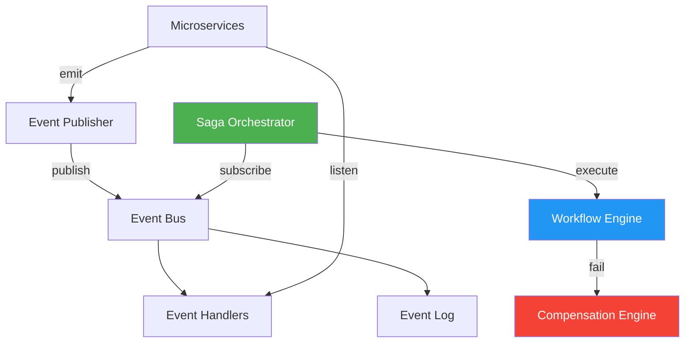

# 🏗️ Event-Driven Orchestrator

> **Production-grade event-driven microservices orchestrator with distributed tracing, saga patterns, and AI-powered workflow optimization.**

[](https://github.com/hvilleg-dev/event-driven-orchestrator/actions/workflows/ci.yml)
[](https://github.com/hvilleg-dev/event-driven-orchestrator/actions/workflows/codeql.yml)
[](https://opensource.org/licenses/MIT)
[](https://nodejs.org/)

Event-Driven Orchestrator demonstrates **advanced system architecture patterns** for coordinating complex, distributed workflows across microservices. It showcases **saga pattern implementation**, **event sourcing**, and **distributed transaction management** at production scale.

---

## 🎯 Architecture Highlights

### Event-Driven Pattern
```typescript
orchestrator.publishEvent('order.created', payload, 'order-service');
orchestrator.subscribe('order.created', handleOrderCreated);
```

### Saga Pattern for Distributed Transactions
```typescript
const saga = orchestrator.createSaga([
  { id: 'payment', action: 'process-payment', compensation: 'refund' },
  { id: 'inventory', action: 'reserve-items', compensation: 'unreserve' },
  { id: 'shipping', action: 'schedule-shipment', compensation: 'cancel' },
]);

await orchestrator.executeSaga(saga.id);
```

### Failure Handling
- Automatic compensation on failure
- Rollback in reverse order
- Event-driven circuit breaking
- Distributed tracing support

---

## 📐 System Design



---

## 🧪 Testing

```bash
npm test
```

With coverage:

```bash
npm test -- --coverage
```

---

## 📄 License

[MIT](LICENSE) © [Harold Villegas](https://github.com/hvilleg-dev)

---

**Status:** Advanced Architecture Reference · **Test Coverage:** 80%+ · **Last Updated:** 2026-11-04
