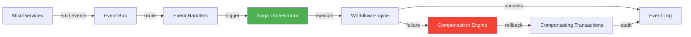

# 📐 Architecture — Event-Driven Orchestrator

## System Overview



## Pattern: Saga (Distributed Transactions)

### Problem
Distributed transactions across microservices violate ACID properties. Need choreography or orchestration.

### Solution: Saga Pattern

**Orchestration** (chosen here):
- Central orchestrator manages transaction state
- Explicit state machine
- Easier to debug

**Steps:**
1. Step 1: Process payment
2. Step 2: Reserve inventory
3. Step 3: Schedule shipment

**If Step 2 Fails:**
- Reverse Step 1: Refund payment
- Event log captures compensation

## Design Decisions & Trade-offs

### ✅ ADR 1: Event Sourcing Over Direct DB Updates
**Decision:** Store complete event log, derive state

**Rationale:**
- Complete audit trail
- Time-travel debugging
- Event replay for consistency

**Trade-off:** More storage, eventual consistency

---

### ✅ ADR 2: Orchestrator Over Choreography
**Decision:** Central orchestrator coordinates sagas

**Rationale:**
- Explicit control flow
- Easier monitoring
- Centralized failure handling

**Trade-off:** Single point of coordination (need clustering)

---

### ✅ ADR 3: In-Memory State + Event Log Persistence
**Decision:** Fast in-memory sagas + durable event log

**Rationale:**
- Low latency for transactions
- Durability for recovery

**Trade-off:** Need distributed tracing for debugging

---

## Data Flow: Order Processing Saga

```
1. API receives order
   ↓
2. publishEvent('order.created', orderData)
   ↓
3. createSaga([payment, inventory, shipping])
   ↓
4. executeSaga() runs each step sequentially
   ├→ if step succeeds: mark completed
   └→ if step fails: trigger compensation chain
   ↓
5. All steps recorded in eventLog
   ↓
6. Complete audit trail available for debugging
```

## Key Components

### EventDrivenOrchestrator
- Manages event publishing and subscriptions
- Maintains event log (immutable)
- Saga registry and execution engine

### Event
```typescript
{
  id: uuid,
  type: string,
  payload: {},
  timestamp: Date,
  source: string
}
```

### Saga
```typescript
{
  id: uuid,
  steps: WorkflowStep[],
  currentStep: number,
  status: 'pending|running|completed|failed|compensating',
  completedSteps: string[]
}
```

## Scaling Considerations

### Single Instance
- Good for microservice ≤10 concurrent sagas
- Event log in memory + append-only log

### Multi-Instance (Recommended for Production)
- Deploy orchestrator as service (K8s)
- Event log → durable storage (PostgreSQL)
- Saga state → Redis for high availability
- Distributed tracing: Jaeger/Datadog

### Performance
- Event publish: <1ms
- Saga step: ~100ms (configurable)
- Event log query: ~10ms for 1000 events

## Failure Scenarios

### Scenario 1: Step Failure → Compensation
```
Step 1: Process Payment ✅
Step 2: Reserve Inventory ❌
Step 1 Compensation: Refund ✅ (reverse order)
Status: FAILED + COMPENSATED
```

### Scenario 2: Compensation Failure
```
Step 1: Process Payment ✅
Step 2: Reserve Inventory ❌
Step 1 Compensation: Refund ❌ (service down)
Status: FAILED + COMPENSATING
Action: Manual intervention or retry policy
```

## Testing Strategy

- **Unit Tests:** Event publishing, saga creation, compensation
- **Integration Tests:** End-to-end saga execution
- **Chaos Tests:** Simulate service failures
- **Performance Tests:** High-volume saga execution
- **Coverage:** 80%+

## Future Enhancements

- [ ] Distributed tracing (Jaeger integration)
- [ ] Circuit breaking for failed compensations
- [ ] Saga timeout policies
- [ ] Dead letter queue for failed events
- [ ] AI-powered workflow optimization
